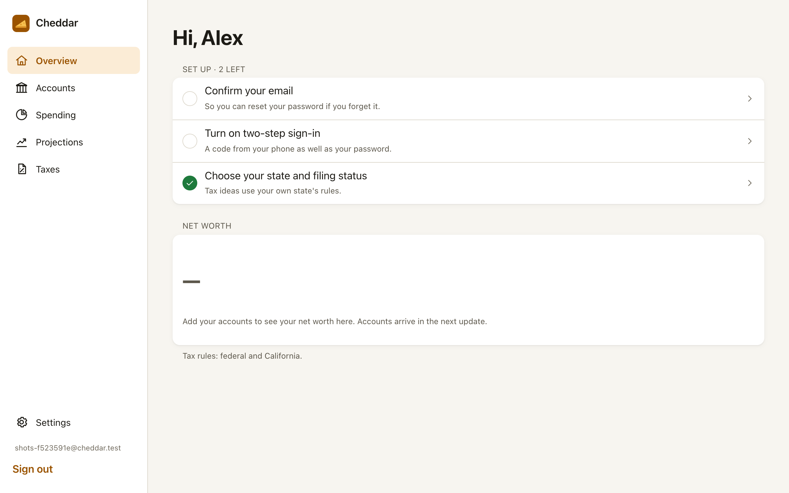
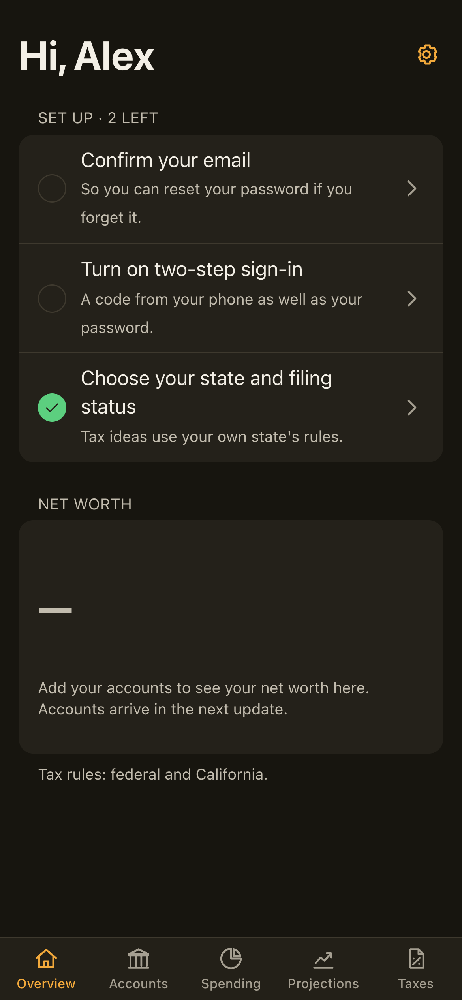
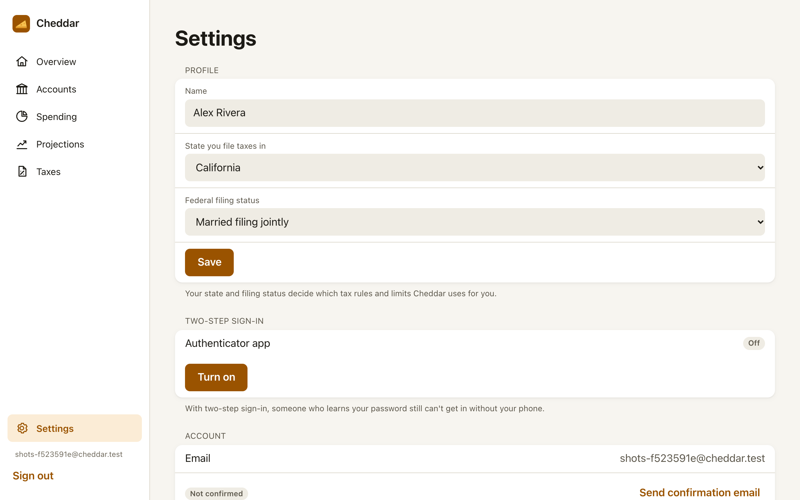
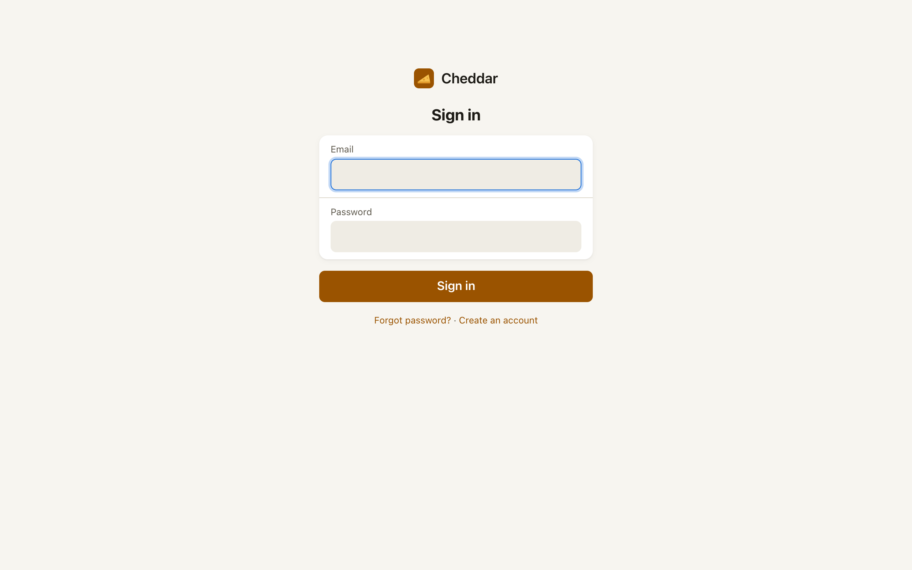

# Cheddar

Cheddar keeps your accounts, net worth, spending and taxes in one place, on
desktop and phone. It's a web app you can add to your Home Screen, so there's
nothing to install from an app store.

**Status:** the foundation is in place: accounts with two-step sign-in, your
profile (state and filing status), the app shell and the deploy pipeline.
The finance features arrive in this order:

1. **Accounts and net worth.** Checking, savings, credit, brokerage,
   retirement, loans and property, plus net worth over time.
2. **Spending.** Import CSV, OFX or QFX files from your bank, sort them with
   category rules, and get weekly and monthly reports.
3. **Projections.** Savings rate, investment growth and debt payoff.
4. **Taxes.** Federal and per-state rules: contribution room, holding
   periods, tax-loss harvesting with wash-sale warnings, and which account
   suits which asset. Cheddar's ideas are educational, not tax advice.

| Desktop | Phone (dark mode) |
| --- | --- |
|  |  |
|  |  |

Cheddar costs nothing to run. Your data comes from files you export from
your bank, not from a paid aggregator. It runs on a home Raspberry Pi
cluster, and the only third-party services it uses are Cloudflare and Mailjet,
both on their free plans.

## Installation and deployment

### Run it locally

You need Node.js 24+, pnpm 10, Docker Desktop and Google Chrome (Chrome is
for the browser test and the icon and screenshot scripts).

```bash
pnpm run setup
pnpm dev
```

`pnpm run setup` installs dependencies, writes `.env`, starts PocketBase in
Docker on port 8095 with a random superuser, applies the schema, and adds a
demo account. Open http://localhost:3005 and sign in as `demo@example.com` /
`Cheddar-demo-1`. `pnpm dev:stop` stops PocketBase.

Without Mailjet keys in `.env`, no mail is sent. To confirm an address
locally, open PocketBase's admin UI at http://localhost:8095/_/ and switch on
the user's `verified` flag.

### Deploy

Every push to `main` runs the full CI pipeline. Once deployment is switched
on, it then deploys to the `cheddar` namespace on the home k3s cluster,
served at `https://cheddar.poweredbycheese.com` through a Cloudflare Tunnel.
[k8s/README.md](k8s/README.md) covers the one-time setup (namespace, runner,
tunnel, repository secrets) and day-to-day operations.

## Usage

- **Create an account.** Passwords need at least 12 characters, and the
  100,000 most common passwords are refused.
- **Set up** (the checklist on the Overview):
  - **Confirm your email.** The link comes by email.
  - **Turn on two-step sign-in.** Go to Settings → Two-step sign-in, scan
    the QR code with an authenticator app (Passwords on iPhone, Google
    Authenticator, 1Password…), and save the ten recovery codes.
  - **Choose your state and filing status** in Settings. Every state and DC
    is available, and tax features use your choice.
- **Install it on a phone:**
  - In Safari, tap Share, then Add to Home Screen.
  - In Chrome on Android, tap ⋮, then Install app.
- **Sign out everywhere** (Settings) ends every session on every device.
- **Delete account** (Settings) removes your account and everything in it.
  It asks for your password.

## System design and architecture

```
browser ──▶ Nuxt 4 (pages + /api routes) ──▶ PocketBase 0.40 (SQLite, auth, hooks)
            httpOnly session cookie            collection rules: each person sees only their own records
```

- **The browser never talks to PocketBase.**
  - The browser calls Nuxt's own `/api` routes (`server/api/`).
  - The PocketBase token stays in an httpOnly cookie, so script on the page
    can't read it.
  - The data layer (`server/data/`) calls PocketBase *as the signed-in
    person*, so PocketBase's collection rules decide what they can see. No
    web request uses a superuser.
- **Sign-in:**
  - The second step needs a password and then a code from an authenticator
    app (TOTP, RFC 6238) or a single-use recovery code (`pb_hooks/two_step.pb.js`).
  - Emailed codes are refused, since whoever reads the inbox can also reset
    the password.
  - Five wrong codes lock the codes for 15 minutes.
  - Sign-in routes allow 10 tries per address in 5 minutes
    (`server/middleware/rate-limit.ts`).
  - Sessions last 3 days and renew on use.
- **Guards on every request:**
  - Mutating requests must come from this site (an Origin check).
  - The CSP is strict and nonce-based (`nuxt.config.ts`).
  - Frames are refused, and HSTS is set.
- **Schema:** `migrations/` holds the schema, which `scripts/migrate.mjs`
  applies as an init container before each new version serves
  ([migrations/README.md](migrations/README.md)).
- **Where code lives:**

  | Path | What |
  | --- | --- |
  | `app/` | Pages, layouts, components and composables (Vue 3) |
  | `server/api/` | HTTP routes |
  | `server/data/` | The only code that talks to PocketBase |
  | `shared/` | Rules both sides use: the state list, filing statuses, the profile check, password rules |
  | `pb_hooks/` | PocketBase hooks. `lib/` is pure and unit-tested, `glue/` touches PocketBase |
  | `migrations/` | The schema |
  | `k8s/`, `scripts/deploy-k8s.sh` | The cluster |
  | `tests/` | Unit, API and browser tests ([tests/README.md](tests/README.md)) |

- **Design** follows Apple's Human Interface Guidelines:
  - the system font and its text styles
  - grouped inset lists
  - a sidebar on desktop and a tab bar on phones
  - 44pt tap targets
  - light and dark mode from one set of colour tokens (`app/assets/css/main.css`)
  - a spinner on every button while its request runs

## CI

`.github/workflows/ci.yml` runs on every PR and every push to `main`, and
again weekly:

- lint, typecheck, unit tests, build and shellcheck
- `pnpm audit` (high and above fails)
- the API suite and a browser smoke test, against the production build and
  the real PocketBase image
- gitleaks (secrets)
- Semgrep (static analysis)
- Trivy (CVEs in dependencies and both images)
- arm64 image builds

The deploy runs only after all of them pass, and only once deployment is
switched on (`DEPLOY_ENABLED`). Dependabot proposes weekly updates, each at
least 7 days old.

## Known gaps

- No backups yet. Litestream to the NAS has to come before real financial
  data does.
- No staging namespace and no uptime alerts.
- PocketBase's SQLite file isn't encrypted at rest. It relies on the SSD on
  `primary` and the cluster's access controls.
