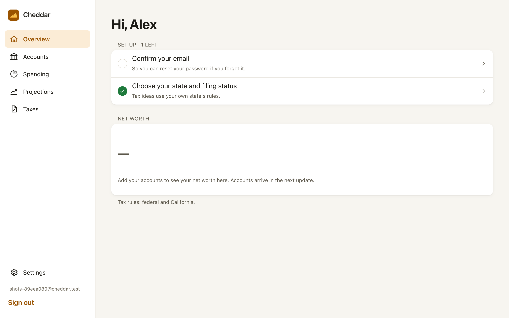
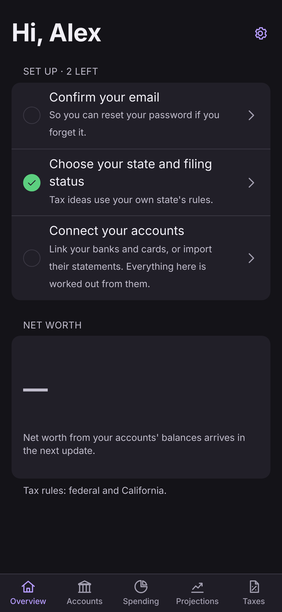
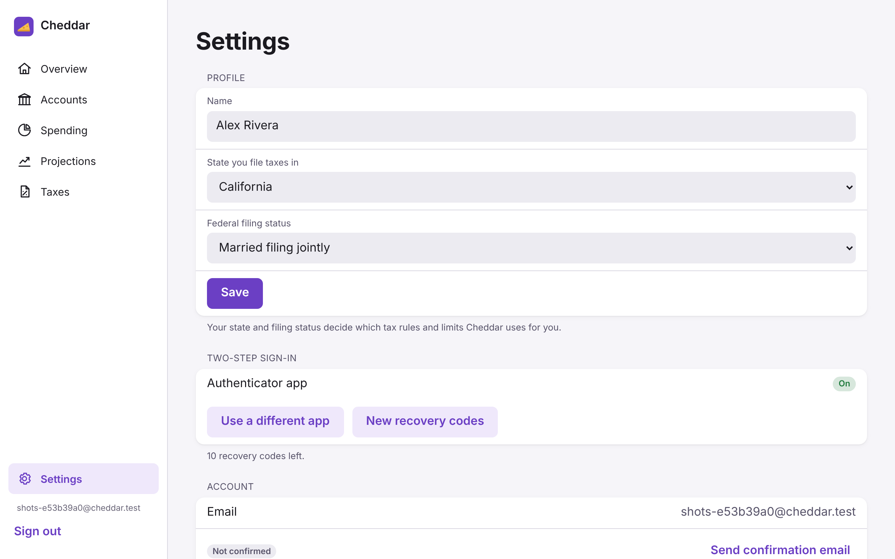
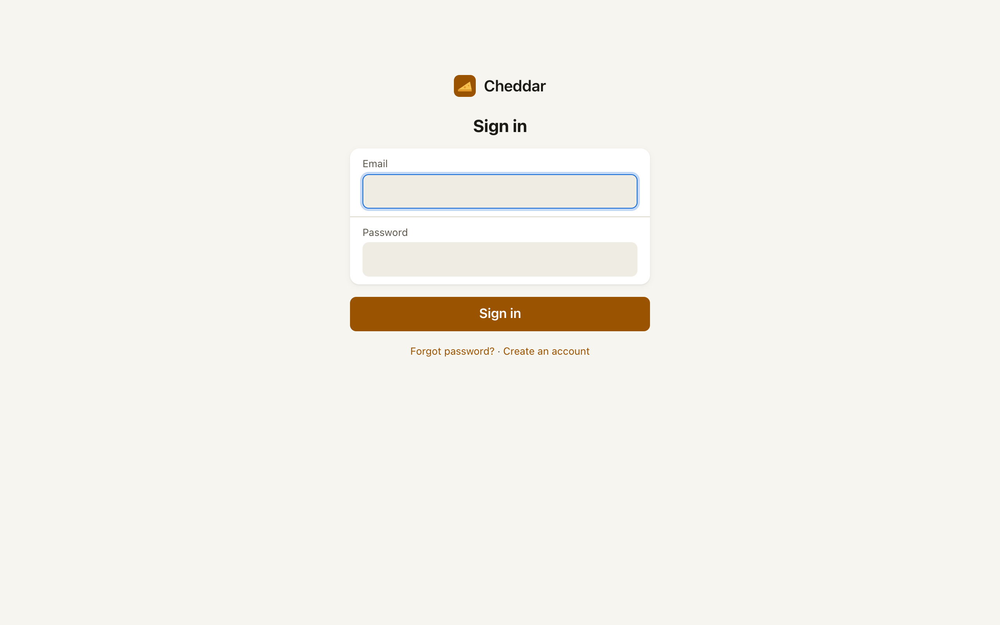
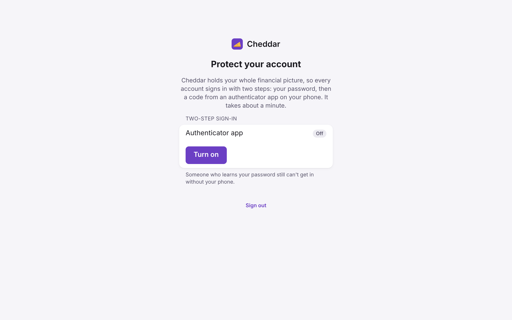

# Cheddar

Cheddar keeps your accounts, net worth, spending and taxes in one place, on
desktop and phone. It's a web app you can add to your Home Screen, so there's
nothing to install from an app store.

**Status:** the foundation is in place: accounts with required two-step
sign-in, your profile (state and filing status), the app shell and the deploy
pipeline. You can add your bank and card accounts and import their
statement files (CSV, OFX or QFX) as transactions, or link them by
signing in to your bank, so transactions arrive on their own.
The finance features arrive in this order:

1. **Accounts and net worth.** Checking, savings, credit, brokerage,
  retirement, loans and property, plus net worth over time.
2. **Spending.** Import CSV, OFX or QFX files from your bank, sort them with
  category rules, review new transactions, and get spending reports.
3. **Planning.** Savings rate, investment growth, debt payoff, savings goals,
  and a cash-flow forecast from planned items and detected regular charges.
4. **Taxes.** Federal and state income tax estimates (every state, and DC)
   for this year or last (last year's first until April 15, while it's being
   filed), contribution room, and ideas from your own figures. Cheddar's
   ideas are educational, not tax advice.

Not planned until Cheddar knows what each account holds (positions and the
lots they were bought in, from Plaid's investments API or a brokerage
export): holding periods, tax-loss harvesting with wash-sale warnings, and
which account suits which asset. Accounts hold only a balance today.

| Desktop | Phone (dark mode) |
| --- | --- |
|  |  |
|  |  |
|  | |

Cheddar costs next to nothing to run. Your data comes from files you export
from your bank, or from banks you link through Plaid, which is free in its
sandbox and for the first few real links, then billed per linked bank to
whoever runs Cheddar (not to the people who use it). It runs on a home
Raspberry Pi cluster, and the only other third-party services it uses are
Cloudflare and Mailjet, both on their free plans.

## Installation and deployment

### Run it locally

You need Node.js 24+, pnpm 10, Docker Desktop and Google Chrome (Chrome is
for the browser test and the icon and screenshot scripts).

```bash
pnpm run setup
pnpm dev
```

`pnpm run setup` installs dependencies, writes `.env`, starts PocketBase in
Docker on port 8095 with a random superuser, applies the schema, and adds a
demo account. Open http://localhost:3005 and sign in as `demo@example.com` /
`Cheddar-demo-1`. The demo account sets up two-step sign-in on its first
sign-in, like every account. `pnpm dev:stop` stops PocketBase.

`docker compose up -d nginx` adds nginx in front of the dev server at
http://localhost:8085, as in production: the country block and rate limits
apply there, and the API suite runs through it.

Without Mailjet keys in `.env`, no mail is sent. To confirm an address
locally, open PocketBase's admin UI at http://localhost:8095/_/ and switch on
the user's `verified` flag.

### Deploy

Every push to `main` runs the full CI pipeline. Once deployment is switched
on, it then deploys to the `cheddar` namespace on the home k3s cluster,
served at `https://cheddar.poweredbycheese.com` through a Cloudflare Tunnel.
[k8s/README.md](k8s/README.md) covers the one-time setup (namespace, runner,
tunnel, repository secrets) and day-to-day operations.

## Usage

- **Create an account.** Passwords need at least 12 characters, and the
  100,000 most common passwords are refused. Whoever runs Cheddar chooses
  who may sign up with `SIGNUP`: `open` (anyone; the default locally),
  `invite` (only the addresses and `@domains` in `SIGNUP_ALLOW`; the
  default in production) or `closed` (k8s/README.md, "First deploy").
  Signing up means ticking that you agree to the Terms of Use (`/terms`)
  and the Privacy Notice (`/privacy`), linked in the footer of every page
  beside the contact form (`/contact`); when the terms change, everyone is
  asked to agree again at their next visit.
- **Turn on two-step sign-in.** Every account must, before anything else:
  scan the QR code with an authenticator app (Passwords on iPhone, Google
  Authenticator, 1Password…), and save the ten recovery codes. It can't be
  turned off. You can move to a new app, or get new recovery codes, in
  Settings.
- **Add a passkey** (Settings → Sign-in and security → Passkeys), and sign
  in with Face ID, Touch ID, your PIN or a security key instead: no password
  or code to type, and a fake sign-in page can't use it. It also works in
  place of the code after the password. Adding one asks for your password
  and emails you; the authenticator app and recovery codes keep working.
- **Finish setting up** (the checklist on the Overview):
  - **Confirm your email.** The link comes by email.
  - **Choose your state and filing status** in Settings. Every state and DC
    is available, and tax features use your choice. Your time zone is taken
    from your device the first time you sign in, and can be changed there too:
    it decides when your day, month and tax year roll over.
  - **Connect your accounts** in Settings → Accounts and banks (below).
- **Pick how it looks** (Settings → Appearance): violet, blue, rose, mint or the original
  Cheddar orange, and light, dark or automatic. It's saved to your account,
  so every device you sign in on matches.
- **Install it on a phone:**
  - In Safari, tap Share, then Add to Home Screen.
  - In Chrome on Android, tap ⋮, then Install app.
- **Set up your accounts** (Settings → Accounts and banks). It's the only
  place accounts are added; Overview, Spending, Investments, Trends and
  Taxes have no setup of their own, and are worked out from what these
  accounts hold. Settings' categories open and close on their headings, and
  all start closed.
- **Link a bank or card** (Settings → Accounts and banks → Linked banks and cards), so balances
  and transactions arrive on their own:
  - Tap **Link a bank or card**, pick your bank, and sign in to it in the
    window that opens (Plaid Link). Your password goes to your bank, never
    to Cheddar; Cheddar keeps only a read-only access token, encrypted.
    The first sync brings up to two years of transactions.
  - Each link then syncs within minutes of the bank having something new
    (Plaid tells Cheddar), once a day regardless, and when you tap **Update
    now**. Pending charges are replaced once they post.
  - When a bank asks you to sign in again, the link says so: tap **Sign in
    again**.
  - Unlinking deletes the access token at Plaid and in Cheddar, and keeps
    the accounts and transactions.
  - With `PLAID_ENV=sandbox`, try it with Plaid's test bank: any bank, user
    `user_good`, password `pass_good`.
- **Or add an account yourself** (Settings → Your accounts), for one you'd rather not link:
  a name, the kind (checking, savings, credit card, loan…), and optionally
  the bank and the last four digits. Then import its statements. Click its
  balance to bring it up to date: one more than 30 days old (180 for
  property) is marked **Out of date**, and Overview says how many are.
  A home or car can change in value by a yearly percent you set on its Edit
  (3 for a home gaining 3% a year, -15 for a car losing 15%): Cheddar moves
  its value on each day, so it doesn't go out of date.
- **Share a budget with your household**: open the category on Spending,
  set its budget and tick Share with your household. Everyone in it sees
  the budget and can change its amount; only you can remove it.
- **Keep a receipt** with a transaction: open it on Spending and choose
  Add a receipt (a photo or a PDF, kept at full size up to 10 MB), for
  warranties, returns or getting paid back. Up to 5 on each, and your
  export includes them.
- **Import a statement** (Import, under Settings → Your accounts):
  - On your bank's website, download your transactions as CSV, or as
    Quicken (QFX) or Money (OFX).
  - Moving from Mint, Monarch or YNAB: export your transactions as CSV
    there, and import the file once for each account, choosing which of
    its accounts to bring in. Categories come across where Cheddar has one
    like them, with merchant names, notes and tags.
  - Choose the account and the file. Cheddar shows what it read before
    saving anything. For a CSV you can change which column is the date,
    description and amount (or separate money out and money in columns),
    whether dates are day first, and whether the file shows money out as
    positive (many card exports do; Cheddar guesses this for cards).
  - Transactions already in the account are skipped, so importing the same
    file twice, or overlapping date ranges, is safe. Two identical rows on the
    same day in one file are both kept.
  - **Undo** next to an import removes the transactions it added.
- **See where your money goes** (Spending): what each category came to in a
  week (Monday to Sunday), a month, a year or a range of dates you pick, for
  one account or all, against the span before. Tap a category for its
  transactions. Spending only shows what your accounts hold: to add more, go
  to Settings.
  - **Budgets:** open a spending category to give it a monthly budget. Its
    bar then shows what's spent against it (red once over), scaled to the
    span shown (a year is twelve months' worth, a week its share by days),
    and Overview lists the categories over budget this month. Tick **Roll
    over** on a budget in the Monthly plan for something that doesn't come
    every month (car repairs, gifts): what each month leaves carries into
    the next, and overspending comes off it, from the month you tick it.
  - **Search** by words (in the description, a name you gave it, or its
    note) and by amount, money in or out, on any date.
  - **Needs review** shows transactions added since the review inbox was
    introduced. Select rows on the current page and mark them reviewed; this
    does not pause automatic categorization.
  - **Add one by hand** (cash, or one a statement missed) to an account that
    isn't linked. Open any transaction to give it a name of your own, add a
    note, or **leave it out** of spending, Overview, Trends and Taxes
    (a reimbursed work expense) while it stays listed. One added by hand can
    be changed entirely or deleted.
  - Every transaction is sorted into a category on its own: by your rule for
    its merchant if you have one, else by the bank's category (linked
    accounts), else by what its description says ("WHOLE FOODS" is
    Groceries). Income and transfers, such as a card payment, aren't counted
    as spending.
  - **In the wrong place?** Open the category, or All transactions, and pick
    another category on the transaction. The merchant's other transactions
    move with it, unless you moved one by hand, and its new ones follow.
  - **Rules** (Settings → Rules): write your own, such as "has *venmo*, in
    Everyday checking: leave it out" or "has *blue bottle*, up to $10:
    Dining, renamed Blue Bottle". A rule matches words in the description or
    payee, an amount's size and an account, and sorts, renames or leaves out
    what it matches, as transactions arrive and, if you ask, the ones you
    already have. The merchant rules Cheddar learned from your changes are
    listed there too, to change or forget.
  - **Your own categories.** Pick "New category…" on any transaction to make
    one and move it there; Cheddar remembers it for that merchant like any
    other. Rename or delete it on its own page; deleting one sorts its
    transactions again on their own.
  - **Tags** cut across categories: "Vacation 2026", "Reimbursable",
    "Tax-deductible". Open a transaction to tag it (a few per transaction).
    Spending lists each tag's total for the period, and the search can find
    every transaction with one tag, on any date.
  - **Transfers and refunds are matched.** Money moved between two of your
    own accounts (the same amount out and in, at most 4 days apart) is a
    Transfer on both sides, so it isn't counted as spending or income. A
    refund from a merchant is matched to its purchase there and counted
    against that purchase's category. Each says so on its row; open one and
    pick "Not a match" if Cheddar got it wrong.
  - **Download CSV** saves the transactions for the period, account and
    category you're looking at as a spreadsheet, tags included.
- **Trends** has two halves. History shows 6 months to 5 years: income
  against spending month by month, any category or merchant over time, where
  the income went (a money-flow chart), and a year in review against the same
  months the year before. Projections shows your savings rate, your
  investments grown on, and when each debt is paid off. Overview keeps a
  12-month summary chart that links there.
- **Plan ahead.** Goals (linked from Overview) track a target, an earmarked
  amount and an optional date. Cash flow (linked from Spending) combines the
  current balances of your own accounts with planned income and expenses and
  detected regular charges over 30, 60 or 90 days. Forecasts are estimates:
  Cheddar never schedules or makes payments. Goals and forecasts do not change
  account balances or net worth. Spending's **Coming up this week** lists
  the next seven days of it, and warns when a subscription's latest charge
  cost more than before.
- **The bell** in the top bar lists what changed or needs you: a bank that
  needs signing in again or stopped syncing, a low balance (the amount in your
  email alerts), a budget passed, bills due in the next 3 days, a price rise,
  a household invitation, new transactions since you last looked, an
  out-of-date typed-in balance and a goal reached. Its badge counts the ones
  you haven't seen; opening it marks them seen. Turn kinds off in Settings →
  Alerts. Nothing is stored but which ones you've seen.
- **Get alerts by email** (Settings → Alerts): a charge over an amount you
  pick, a checking or savings balance under one, bills and planned payments
  due in the next 3 days, a budget passed this month, a bank that needs you
  to sign in again, and a summary of the week on Mondays. Each is sent once,
  several together in one email, and only to a confirmed address. Charges
  and banks are looked at every hour, the rest once a morning ("Check now"
  looks at once). They go out through Mailjet, so `MAILJET_*` must be set.
- **Share selected accounts with a household** (Settings → Household). The
  owner invites verified Cheddar users; an invite must be accepted before
  access is granted. Household members can see selected accounts and their
  transactions, and edit transaction names, notes, tags and exclusions. Only the
  owner can manage accounts, balances, bank links, categories and merchant
  rules. Unshared accounts, tax settings, Trends' projections, cash-flow schedules and
  personal exports remain private. Removing a member or unsharing an account
  revokes access immediately.
- **Export your data** (Settings → Your data): a zip of `accounts.csv`,
  `transactions.csv` and `balance_history.csv`, and `cheddar.json` with
  everything you own, including goals and planned cash flow, your categories
  and rules too. Shared accounts owned by someone else are not in
  your export. It asks for your
  password, and never holds a bank link's token or a two-step secret. A
  cell a spreadsheet would run as a formula (`=`, `+`, `-`, `@`) starts
  with `'`. Delete account offers it first.
- **Change your password** (Settings → Account) with your current one. Every
  other device is signed out; this one stays signed in.
- **Change your email** (Settings → Account): your password, then a link
  sent to the new address, which asks for your password again. The old
  address is told when the change is asked for and when it's done, and every
  device is signed out once it moves.
- **Sign out everywhere** (Settings) ends every session on every device.
- **Delete account** (Settings) removes your account and everything in it.
  It asks for your password.

## System design and architecture

```
browser ──▶ Cloudflare ──tunnel──▶ nginx ──▶ Nuxt 4 (pages + /api routes) ──▶ PocketBase 0.40 (SQLite, auth, hooks)
                                   country block,  httpOnly session cookie       collection rules: each person sees only
                                   rate limits                                   their own records, and only with two-step on
```

- **The browser never talks to PocketBase.**
  - The browser calls Nuxt's own `/api` routes (`server/api/`).
  - The PocketBase token stays in an httpOnly cookie, so script on the page
    can't read it.
  - The data layer (`server/data/`) calls PocketBase *as the signed-in
    person*, so PocketBase's collection rules decide what they can see. No
    web request uses a superuser.
- **Sign-in:**
  - Two-step sign-in is required. Signing in needs a password and then a
    code from an authenticator app (TOTP, RFC 6238) or a single-use recovery
    code (`pb_hooks/two_step.pb.js`).
  - The requirement is enforced by PocketBase's collection rules
    (`migrations/0002_require_two_step.mjs`), not only by the pages. A
    password-only session can set up two-step, sign out or delete the
    account, and nothing else.
  - Emailed codes are refused, since whoever reads the inbox can also reset
    the password.
  - The app's secret is stored encrypted with the newest data key, and
    recovery codes only as an HMAC with it, so a copy of the database alone
    can't make anyone's codes. `DATA_KEYS` lists the keys newest first
    (`BANK_LINK_KEY`, from before it, is key v1); each value names its key,
    so a key can be rotated (`pb_hooks/lib/data_keys.js`,
    `pb_hooks/data_keys.pb.js`; k8s/README.md "Rotating the data key").
  - Five wrong codes lock the codes for 15 minutes, and each lockout after
    that lasts twice as long (up to a day) until a right code. A lockout
    after a right password, a new authenticator app, new recovery codes, a
    new passkey, a changed password, a sign-in from a device and country not
    seen before, a newly linked bank and a deleted account each email the
    person (`pb_hooks/lib/notices.js`).
  - Changing the password or email needs the current password
    (`pb_hooks/credentials.pb.js`); PocketBase's own email-change request,
    which doesn't, is refused.
  - Sessions last 3 days and renew on use, for at most 30 days after the
    sign-in. Each sign-in is a device (`sessions`, `pb_hooks/sessions.pb.js`):
    PocketBase honours a token only beside its device's id, which Nuxt keeps
    in a second httpOnly cookie, so signing out ends the device for real and
    Settings lists devices and signs any one out. Linking or unlinking a bank
    wants the password typed in the last 15 minutes.
- **nginx** (`nginx/nginx.conf.template`) sits between the tunnel and Nuxt:
  - It refuses visitors from China, Russia, India, North Korea, Iran and
    Belarus, by Cloudflare's `CF-IPCountry`.
  - It rate-limits every POST that checks a password or a code (10 a minute
    per address, bursts of 5), sends mail (5 a minute) or creates an account.
  - It shows a holding page while the app restarts, and tells Cloudflare
    never to cache anything.
- **Guards on every request:**
  - Mutating requests must come from this site (an Origin check).
  - The CSP is strict and nonce-based (`nuxt.config.ts`).
  - Frames are refused, and HSTS is set.
- **Bank links** (`pb_hooks/bank_links.pb.js`, `pb_hooks/glue/bank_links.js`, which writes through `glue/sync_rows.js` and `glue/sync_holdings.js`,
  through a provider in `pb_hooks/glue/providers.js`; Plaid is
  `pb_hooks/glue/providers/plaid.js` and `pb_hooks/lib/plaid.js`):
  - The person signs in to their bank in Plaid Link, which hands the page a
    short-lived public token. PocketBase swaps it for an access token with
    Plaid's secret (`PLAID_CLIENT_ID`, `PLAID_SECRET`, `PLAID_ENV`), so the
    bank password never reaches Cheddar, and the token is useless without
    that secret. It reads balances and transactions; it can't move money.
  - The access token is stored encrypted with the newest data key (AES-256,
    `DATA_KEYS` below),
    in a collection no record API rule opens. Only the hooks read it, and it
    never reaches Nuxt or the browser. Without the keys, linking is off.
  - Syncs use `/transactions/sync` from a saved cursor, and write through
    the hooks, as the link's owner, into the same `accounts` and
    `transactions` file imports use; `external_id` (`plaid:…`) makes a
    re-sync update rather than duplicate.
  - The CSP allows Plaid Link's script and frame (`cdn.plaid.com`).
  - Plaid bills whoever runs Cheddar per linked bank, so new links stop at
    `PLAID_LINKS_PER_PERSON` (default 10) and `PLAID_MAX_LINKS` for the
    whole instance (0, no limit, unless set; 25 in production). Settings
    says so before anyone signs in to their bank, and the log notes each
    refusal.
- **Schema:** `migrations/` holds the schema, which `scripts/migrate.mjs`
  applies as an init container before each new version serves
  ([migrations/README.md](migrations/README.md)).
- **Where code lives:**

  | Path | What |
  | --- | --- |
  | `app/` | Pages, layouts, components and composables (Vue 3) |
  | `server/api/` | HTTP routes |
  | `server/data/` | The only code that talks to PocketBase |
  | `shared/` | Rules both sides use: the state list, filing statuses, the profile check, password rules |
  | `pb_hooks/` | PocketBase hooks. `lib/` is pure and unit-tested, `glue/` touches PocketBase |
  | `migrations/` | The schema |
  | `nginx/` | nginx's config, holding page and start script |
  | `k8s/`, `scripts/deploy-k8s.sh` | The cluster |
  | `tests/` | Unit, API and browser tests ([tests/README.md](tests/README.md)) |

- **Design** is a calm dashboard:
  - one bar across the top in the theme's colour with the sections in it;
    on phones the sections move to a tab bar at the bottom
  - white cards with a hairline border on a soft grey ground, each a titled
    panel (`.panel-head`), side by side in columns on a wide screen
  - Overview lists every account by kind down the left, adding up to net
    worth, with the figures and charts beside it
  - the system font
  - 44pt tap targets
  - light and dark mode from one set of colour tokens (`app/assets/css/main.css`),
    each a `light-dark()` pair, with an override set per colour theme
  - a spinner on every button while its request runs

## CI

`.github/workflows/ci.yml` runs on every PR and every push to `main`, and
again weekly:

- lint, typecheck, unit tests, build and shellcheck
- `pnpm audit` (high and above fails)
- the API suite and a browser smoke test, through the nginx image, against
  the production build and the real PocketBase image
- gitleaks (secrets)
- Semgrep (static analysis)
- Trivy (CVEs in dependencies and all three images)
- arm64 image builds

The deploy runs only after all of them pass, and only once deployment is
switched on (`DEPLOY_ENABLED`). Dependabot proposes weekly updates, each at
least 7 days old.

## Known gaps

- Backups (Litestream to the NAS, encrypted, with a restore drill) are off
  until their settings are in (k8s/README.md, "First deploy" step 11).
- No staging namespace. Uptime alerts are off until `HEALTHCHECK_URL` and
  `HEALTHCHECK_SYNC_URL` are set (k8s/README.md, "First deploy" step 10).
- PocketBase's SQLite file isn't encrypted at rest. It relies on the SSD on
  `primary` and the cluster's access controls.
